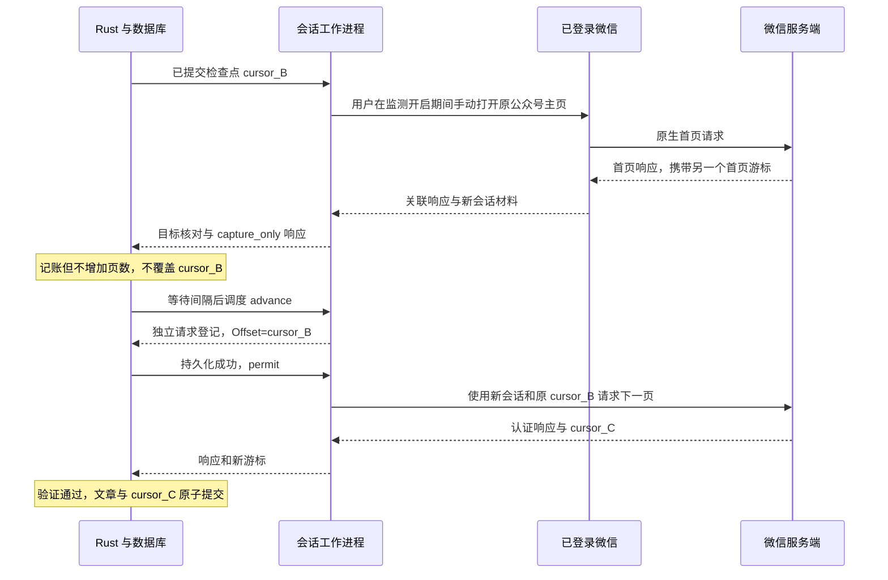

# 微信会话采集：密钥、游标与完整流程

本文对应当前项目的 Windows 会话采集实现，说明公众号如何识别、密钥从哪里取得、独立请求如何构造，以及服务端游标如何成为可恢复的检查点。操作步骤见[会话采集使用说明](session-collector.md)。

当前实现仅适配模块摘要及函数指纹匹配的 **微信 4.1.15.56**。这是已实测行为与本项目实现的记录，不是微信公开协议规范，也不代表所有微信版本都使用相同结构。

## 整体流程

首次请求由已登录微信发出；后续翻页由 Python 工作进程独立发送。Rust 负责调度、预算、身份核对、入库和检查点，前端只展示状态，不接收会话密钥。

```text
用户开启监测 → 手动打开公众号主页 → 核对模块与唯一请求/响应
    → 认证完整会话 → DPAPI 保存 → 登记公众号、会话与首页游标
用户发起首页/历史任务 → 预算闸门 → 请求先计账再发送
    → 双层认证解密 → 核对身份、业务结果与游标 → 原子提交文章和检查点
```

监测只登记材料，不入库文章。微信自身已发出的请求在观察后登记；独立请求须在持久化计账成功并取得许可后发送。程序不自动刷新或操作微信窗口。

## 公众号身份从哪里取得

本路径不启用 HTTP 代理、不安装根证书。Frida 在本机观察微信原生桥的函数参数与回调；读取列表业务数据时，微信已经完成自身的解密和协议处理。

| 字段 | 来源及用途 |
|---|---|
| CGI `5814` | 当前适配中的文章列表调用，用来识别目标业务 |
| `hwnd`、回调编号 | 关联目标窗口中的请求与响应，避免其它页面和复用编号的回调混入 |
| `BizUserName` | 列表请求中的公众号客户端标识 |
| `AccountInfo.UserName` | 响应中的客户端标识，必须与请求一致 |
| `AccountInfo.NickName` | 响应中的显示名称，作为只读公众号名称 |
| 文章链接的 `__biz` | 文章所属公众号标识，逐篇核对后保存为任务的 `biz` |

只接受唯一关联的列表响应。首次识别通过 `target_detected` 事件登记名称和账号，此时不增加已处理页数、不移动游标、不写入文章。用户发起首页任务且完整会话校验通过后才提交文章；后续请求和暂停恢复继续核对同一账号。

## 会话材料与取得方式

观察器只在已验证模块范围内寻找支持的密码结构，并在用户手动打开或刷新主页期间采样。字段候选去重后有数量上限，不把最先出现的后台密码调用直接认定为列表会话。

| 材料 | 当前格式 | 取得方式 | 用途 |
|---|---|---|---|
| `psk` | 32 字节，导出为 hex | 在 profile 指定且指纹匹配的会话函数返回时观察输出对象 | 派生外层发送和接收密钥 |
| `inner_enc_key` | 24 字节，hex | 观察密码初始化函数，按 24 字节密钥及加密方向识别，并认证请求候选 | 内层 AES-192-GCM 请求加密 |
| `inner_dec_key` | 24 字节，hex | 观察密码初始化函数的解密方向 | 内层响应解密候选字段 |
| `inner_dec_candidates` | 最多 8 个 24 字节候选 | 保存不同的接收密钥候选 | 独立响应逐个尝试，以 GCM 认证结果确定可用密钥 |
| `ch_template` | 当前为 161 字节，hex | 捕获 `POST /mmtls/…` 的第一个 MMTLS 记录体 | 构造新 ClientHello |
| `hs_template` | 当前为 20 字节，hex | 用 PSK 派生的发送密钥认证解密捕获请求 | 构造客户端扩展握手及响应派生摘要 |
| `alert_template` | 当前为 7 字节，hex | 认证解密捕获请求中的结束记录 | 构造结束记录 |
| `req_template` | Protobuf 字节，hex | 观察外层加密前的业务候选，再用内层发送密钥认证解密并解压 | 保留业务结构，递归修改列表 JSON |
| `inner_body_header` | 二进制包头，hex | 从已验证的业务候选中保留 | 维持客户端封装及会话字段，翻页时更新长度 |
| `host`、`path` | 字符串 | 从捕获的业务封装读取 | 限定独立请求的微信主机及业务路由 |
| `target_name`、版本、模块摘要、取样时间 | 元数据 | 关联响应和 profile | 标识材料来源与适配范围 |

PSK 和内层密钥来自运行时观察；外层 AES 密钥及 IV 则按握手材料计算。当前会话文件不会单独持久化每次请求派生出的外层密钥。

取样阶段使用 PSK 对捕获请求的加密记录做认证，并使用内层发送密钥验证业务候选，检查其中的列表路由和账号。`hs_template`、`alert_template` 最终来自认证解密的真实记录；观察器记录的小块明文不能单独作为可信握手模板。

**接收密钥的确认发生在独立响应解密时。** 取样文件可能保存多个接收候选，不能仅凭 `inner_dec_key` 字段存在就声称该值已通过所有响应验证。响应处理会尝试候选并以认证成功者为准；当前选中结果更新本次内存载荷，不应假定它已经覆盖磁盘 vault。

## 独立请求的两层封装

列表参数不是直接作为 HTTP JSON 发送。当前实现的层次为：

```text
HTTP POST /mmtls/随机后缀
└─ MMTLS 记录：握手、加密应用数据、结束记录
   └─ 应用数据：业务路径 + 主机 + 内层业务包
      └─ 内层包头 + 密文 + 12 字节 nonce + 16 字节 GCM tag
         └─ 认证解密后：zlib 压缩的 Protobuf
            └─ 子消息中的列表 JSON：BizUserName / ActionType / Offset
```

当前代码使用普通 HTTP 连接承载 MMTLS 二进制数据；业务内容的保护来自 MMTLS 和内层 GCM。它不是直接发送明文列表 JSON，也不是普通 HTTPS JSON API。

### 构造请求

`page_payload()` 递归定位唯一包含 `BizUserName` 的 JSON，写入 `ActionType=1` 和上页返回的 `Offset`，保留其它字段，并更新各层 Protobuf 长度及内层包头的两个载荷长度字段。该操作只改变请求参数与封装，**不生成游标**。

随后 `build_request()` 更新 ClientHello 的 32 字节随机数、ClientHello 与扩展握手中的同一个时间戳，并生成新的 12 字节内层 nonce。压缩后的业务载荷使用 24 字节发送密钥执行 AES-192-GCM 加密。

外层发送密钥及 IV 的计算如下，其中 `CH` 指本次 ClientHello 的记录体，`||` 表示字节拼接：

```text
info = b"early data key expansion" || SHA256(CH)
material = HKDF-Expand-SHA256(key=PSK, info=info, length=28)
send_key = material[0:16]
send_iv  = material[16:28]
```

这里使用 HKDF-Expand，不能擅自再增加一次 Extract。外层采用 AES-128-GCM；记录 nonce 为 12 字节 IV 与记录序号的整数异或，AAD 为 8 字节大端序号拼接 5 字节记录头。当前请求首个明文记录后，加密记录使用序号 1、2、3。

程序会先在本地认证回解新建请求，确认封装和明文模板一致后才发送。

### 解密响应

响应外层的派生摘要包含本次客户端扩展握手明文，不能只使用两端 Hello：

```text
transcript = CH || 本次客户端扩展握手明文 || ServerHello记录体
info = b"handshake key expansion" || SHA256(transcript)
material = HKDF-Expand-SHA256(key=PSK, info=info, length=28)
receive_key = material[0:16]
receive_iv  = material[16:28]
```

全部外层加密记录必须通过认证，应用数据分片在认证后拼接；再尝试内层接收密钥候选，通过 GCM 验证后解压并递归读取 Protobuf 中的业务 JSON。Rust 随后核对真实业务返回码、账号、文章所属公众号和游标关系。

独立请求没有原生桥或 JSAPI 返回码，账本中对应值保持空；不能为独立请求伪造这两层的 `ret=0`。外层和内层认证通过，也不等于业务成功；业务返回码仍须另行核对。

## 游标的来源、传递与落盘

游标由服务端响应的 `MsgList.PagingInfo.Offset` 提供，是不透明字符串。程序不计算页码偏移、不解码其内部含义，也不根据文章数量拼出下一页参数。下面只展示业务字段，示例值均为虚构值，不是完整报文。

首页或上一页响应中的分页部分：

```json
{
  "MsgList": {
    "PagingInfo": {
      "Offset": "DEMO_CURSOR_A",
      "IsEnd": 0
    }
  }
}
```

下一页请求中嵌套的列表 JSON：

```json
{
  "BizUserName": "fake-account",
  "ActionType": 1,
  "Offset": "DEMO_CURSOR_A"
}
```

下一页若返回 `DEMO_CURSOR_B`，再下一次请求就携带 B。`IsEnd=1` 表示结束；未结束时必须有游标和有效文章列表。第一页的请求动作必须是首页；后续请求动作必须是翻页，且请求游标必须等于上次已提交检查点。未结束却返回与本次请求相同的游标时暂停。

工作进程先从响应取出下一游标作为临时值；Rust 验证通过后，在同一数据库事务中提交文章、任务进度、原始游标和请求结果。工作进程里的临时值不能取代已提交检查点。

| 位置 | 保存内容 | 是否包含原始游标 |
|---|---|---|
| `native_jobs.cursor` | 当前任务最后一次已提交检查点 | 是 |
| 运行时 `config.json` 的 `_resume_cursor` | 恢复任务时传给工作进程的检查点 | 是，属于本地运行配置 |
| `native_call_log.request_cursor_hash`、`response_cursor_hash` | 请求与响应的游标短哈希 | 否，不能据此恢复原值 |
| 会话 JSON 的业务模板 | 取样请求当时的原参数 | 可能包含当时的 `Offset`，但不是任务进度 |

## 暂停恢复为何不会回到新首页游标

恢复需要重新准备会话材料，但采集进度来自数据库。会话模式保留原页数和游标，清空可能失效的导入路径，再从同一公众号主页取样。



换公众号、会话认证失败、结构变化或游标未推进都会暂停。程序不会自动重试失败请求，也不承诺跨会话游标永远有效；验证范围见 [工作台验证说明](windows-workbench-validation.md)。

## 材料存储与文件对应

正常运行时，会话保存为当前 Windows 用户 DPAPI 保护的 `native-runtime/session-vault.dat`；只有用户显式导出才生成可读 JSON。文件包含完整密钥和业务模板，不能仅把其中某个字段理解为通用登录凭证。

取样在独立子进程中进行，材料交付后最多等待 2 秒正常退出，必要时终止该取样子进程。后续独立翻页不再依赖 Frida 挂钩；材料过期时重新取样，不代表永久脱离客户端登录状态。

## 代码定位与已验证范围

| 职责 | 实现 |
|---|---|
| 版本指纹与取样适配 | [profile](../native/profiles/4.1.15.56.json) |
| 运行时 PSK、密钥候选与发送缓冲观察 | [session_agent.js](../native/session_agent.js) |
| 桥请求与响应关联 | [worker.py](../native/worker.py) 中的 `Messages` |
| 自动识别、子进程回收、游标交付及请求许可 | [session_worker.py](../native/session_worker.py) |
| GCM、派生、嵌套 Protobuf 改写和独立 HTTP 请求 | [session_protocol.py](../native/session_protocol.py) |
| DPAPI 存储 | [session_vault.py](../native/session_vault.py) |
| 调度、预算、响应核对及恢复 | [runtime.rs](../crates/core/src/native/runtime.rs) |
| 业务解析、身份和游标校验 | [protocol.rs](../crates/core/src/native/protocol.rs) |
| 只读目标绑定及文章与检查点事务 | [store/native.rs](../crates/core/src/store/native.rs) |

离线回归覆盖认证篡改、身份不匹配、嵌套参数改写、子进程回收、请求许可与检查点恢复。离线测试使用虚构材料，不发送真实微信请求。构建、安装、采集与长期稳定性分别验收，详见 [验证范围](windows-workbench-validation.md)。
