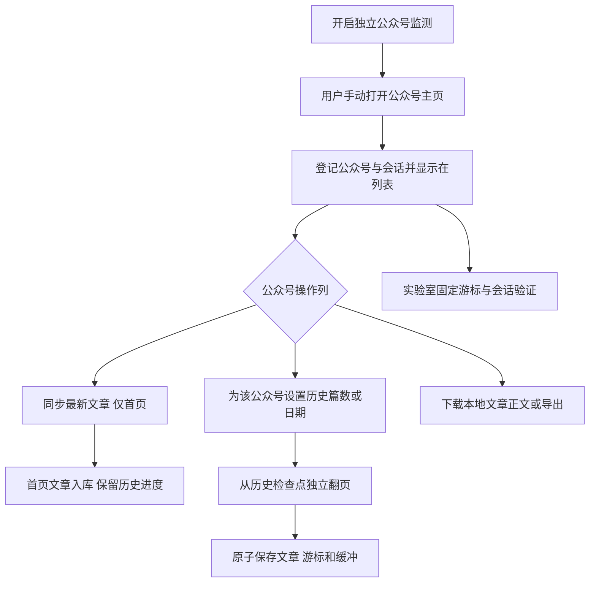

# Windows 多公众号批量采集与本地阅读

本文说明最新整合后的当前契约。监测与采集分离、自动恢复、统一分页及正文状态操作分别见[按公众号操作](source-actions.md)、[会话恢复](home-sync-recovery.md)、[分页](pagination-tasks.md)和[底栏与文章操作](status-progress-article-actions.md)。历史验证记录按当时版本解释，不将旧候选包验收套用于最新发行。

## 模块与边界

默认入口：公众号、文章库、任务、限流配置、系统日志、系统设置、常见问题。实验室由“系统设置 → 系统配置 → 显示实验室”开启，默认隐藏。公众号监测、首页同步、历史任务与正文任务互相独立；监测不自动入库文章。入口以[按公众号操作契约](source-actions.md)为准。

## 历史与游标

首页快照和历史检查点分开。刷新首页、重新取样会话不覆盖历史进度。每页响应对应一条游标记录，记录所属源、会话版本、父游标、SHA-256、首次观测和最后成功时间。游标原值从 DPAPI 页面证据读取；普通 IPC 不返回原值。

追加 N 篇从已有历史覆盖边界继续，按去重覆盖计数，不以本次数据库 INSERT 数量计数。整页文章先落库，未消费部分保存为缓冲；下一任务优先消费缓冲。日期由前端按本机时区转换至截止日零点，包含当天；使用连续两页全部早于截止日作为保守边界，单个置顶旧文不会停止任务。无法获取发布时间的文章不会被推断为早于截止日。

会话更新后先尝试旧历史游标。只有同会话首页、新游标分页成功且原游标重复业务失败，才确认该会话下不可复用。确认后可以按稳定文章边界从首页重建，默认每任务最多一次，可配置；边界不完整时暂停，不猜页号或跳过内容。

旧原生任务若存在真实历史游标，首次准备会话时将原值转入 DPAPI 文件，标为“旧检查点待验证”，保留原观测时间并优先尝试复用。旧库缺少的逐页文章边界不补造；这种检查点确实失效且无法定位历史边界时，要求人工决定，而不是静默重头翻页。

## 实验室

开启实验室后，每公众号展示工作台统一引用的当前游标，可获取下一页。选择游标启动新实验时默认固定该公众号最新会话，也可显式选用获取游标时的原会话作对照；旧实验会话不改变。实验固定原始 Offset。默认 0 小时基线加 1–24 小时验证，用户可调整未来时点；报告记录实际发送时刻和游标自首次观测起的年龄。响应的新 Offset 仅做证据，不推进正式历史检查点。

每个时点允许最多 5 分钟调度延迟，以兼容配置的间隔和其他列表请求；超过后记录缺测，不集中补发。24 小时截止不继续发送新请求；已发送请求允许完成。退出/休眠后的未来时点继续恢复，已错过时点保存缺测。

请求经过同一列表闸门。到期实验优先，预算、全局冷却及请求串行仍生效。网络与未知错误只保留证据；认证失败、会话过期（服务端返回 H5 Session Timeout，单列为 `session_timeout`）与会话/协议故障都结束为无法判断，不混入游标失效证据。疑似游标失败执行同会话首页、新游标分页和原游标复测，所有对照计费；更换会话请创建新实验。

结论为该频率下至少观测到的可用年龄、最后成功至确认不可复用的区间，或证据不足。会话过期（`session_timeout`）或认证失败只截断观察窗口：已证实的可用下界保留在结论里，不因后续时点停止而被合掉。重复使用可能改变有效期，此实验不测闲置寿命，也不声称精确服务端 TTL。24 小时观察上限不用于自动淘汰生产游标。早期观察中单样本旧游标约 33 小时后配合新会话成功复用；这是该样本的成功复用年龄，不是所有游标的统一TTL、最低寿命或闲置寿命，详见[真实对照](cursor-lifetime-validation-20261023.md)。

文件位于数据目录 `workbench/experiments/<实验ID>/`：`results.json`、`report.md`。原始协议响应和已解密业务体保存在 `workbench/private/pages/*.dat`，使用当前 Windows 用户 DPAPI 保护。报告保留证据文件引用；凭据独立保存，不进入普通导出。

## 请求与限流

列表（包含实验）、正文、图片分别控制。列表串行，正文和图片初始并发各 4、同类间隔各 1000ms；列表初始 90–120 秒、滚动 24 小时预算 60。全部为可编辑初始值，列表间隔支持 0 毫秒，不存在 60 秒硬下限。冷却初始 300 秒，可配置。

所有独立请求先将唯一请求 ID、用途、策略版本和时间写入账本，再获准发送。正文、图片、重试、验证对照、历史重建都记账。原生请求只统计 `native_call_log`，不重复拼接其旧 `list_call_log` 镜像。窗口观察到的微信附带请求也计数，但不声称能够控制微信自身的全部后台流量。

策略变更从下一次未发送请求生效；在途请求继续完成。HTTP 429 和明确频率信号进入共享冷却；5xx 不直接判为微信封禁。原生错误码保留分层返回值，不套用旧 getmsg 的 -3/-6 含义。

HTTP 200 会继续检查内容：验证页、不可用正文、空正文、无效编码或图片格式分别记录，状态码仍保留。验证页没有已知有效对照时暂停当前正文任务，标为证据不足；有效对照也要求验证才触发全局冷却。

## IPC 契约

Rust 类型在 `workbench/mod.rs`，TypeScript 类型在 `frontend/src/lib/workbench.ts`，Tauri 为薄封装。

|命令|输入|结果/副作用|
|---|---|---|
|`workbench_sync_home`|biz|创建或复用该公众号的首页同步任务，不改变历史进度|
|`workbench_snapshot`|无|公众号、游标元数据、任务、实验、近24小时最近2000条请求、策略、正文缓存状态（列表使用独立分页命令）|
|`workbench_discovery_start`|`pythonPath`, `target=null`|兼容旧监测调用；拒绝全局采集目标，仅登记公众号、会话与游标，不入库文章或创建采集任务|
|`workbench_home_sync_start`|`pythonPath`|幂等开启独立监测；不操作微信窗口、不发起采集|
|`workbench_recover_session`|任务 `id`, `pythonPath`|登记恢复意图；已有可用新会话时恢复，否则等待目标主页完整交付|
|`workbench_source_page`|`search`, `limit`, `offset`|完整匹配范围的公众号分页及总数，附对应首页/历史任务|
|`workbench_task_page`|`kind`, `limit`, `offset`|按home/history/archive任务类型分页及总数，archive仅表示正文下载|
|`workbench_request_page`|`category`, `since`, `limit`, `offset`|请求明细分页及完整匹配总数|
|`workbench_discovery_stop`|无|停止监测、撤销等待中的自动继续意图；不取消其他已创建任务|
|`workbench_capture`|`pythonPath`, `expectedBiz?`|旧的单次取样入口，已从主界面隐藏|
|`workbench_next_page`|`biz`|在事务内绑定当前游标创建单页任务；保留分叉历史检查点与缓冲|
|`workbench_history`|`bizzes`, `target: {count}` 或 `{cutoff_at}`|事务创建每号历史任务；同号未结束任务拒绝重复|
|`workbench_source_counts`|无|返回各公众号未删除文章的实际篇数，包含旧库公众号|
|`workbench_archive_source`|`biz`|事务内固定该号全部未删除文章 ID，统一去重入队并返回 DownloadReceipt|
|`workbench_export_source`|`biz`|先校验全号已入库文章均有本地正文，再选择目录并同时导出 Markdown 与 HTML；取消返回null，不写文件|
|`workbench_task_action`|`id`, `pause/resume/cancel`|持久化状态；恢复沿用检查点|
|`workbench_policy`|完整策略|返回新版本；普通调频不能清掉现有冷却|
|`workbench_experiment`|`cursorId`, `scheduleHours`|创建固定游标/会话实验，自动添加基线|
|`workbench_experiment_cancel`|`id`|结束实验并保存已有报告|
|`workbench_report`|实验 `id`|生成或更新真实 JSON/Markdown 报告并返回路径|
|`workbench_probes`|实验 `id`|计划/实际时间、游标年龄、结果、证据引用|
|`workbench_reader`|`articleId`|返回离线清洗 HTML，内联本地图片；不接受任意文件路径|
|`workbench_export_requests`|无|全部已保存请求 JSON 文件路径|

数据库新增表统一 `wb_` 前缀，不添加 FOREIGN KEY。关联验证和检查点推进在 Store 事务中完成。运行中的任务重启后暂停，实验保留计划；中断请求保留消耗与 interrupted 状态。存储失败直接提示启动错误，不退化到可丢失的内存数据库。

## 正文下载与本地阅读

正文队列固定创建时的文章 ID，列表新增文章不会进入已有队列。正文、封面及正文图片保存至 `workbench/archive/articles/<文章ID>/`。原始 HTML 作为证据保存；阅读使用清洗 HTML，脚本、事件属性及远程图片不自动执行或加载。图片缺失保留正文和已下载图片，标为 partial，正文缓存补齐路径复用已有文件。

每篇保存 `original.html`、`index.html`、`article.md`、`metadata.json`、`manifest.json` 和 `images/`。稳定数字 ID 与哈希文件名避免 Windows 非法字符与过长标题路径。ZIP归档已移除，旧任务在启动时取消，不能新建或恢复；已有文件和记录保留。正文下载、本地阅读、Markdown/HTML和实验数据导出继续可用。

## 运行与自动化

默认使用应用数据目录。预览/诊断可通过 `MPIDER_DATA_DIR` 指定独立数据目录。桌面和诊断运行器共享文件锁，防止同一数据目录启动两个调度器。托盘退出停止调度；首版不自动唤醒专机或安装 Windows 服务。

`cargo build -p mpider-core --example workbench_ctl` 构建诊断入口。`workbench_ctl <数据库完整路径> snapshot <文件>` 保存元数据快照，`history <JSON>`、`download <ID逗号列表>`、`experiment <游标ID> [小时列表或 now] [固定会话ID]` 事务入队。`run [秒数]` 在桌面未运行时运行队列。`capture <原生配置JSON>` 仅取当前主页第一页。`task-action <任务ID> pause|resume|cancel` 控制队列，`report <实验ID>` 重生成报告。`capture` 输出实际状态、页数和暂停原因，未成功完成一页返回非零退出码，便于自动化判断。诊断入口不导出会话密钥。

## 验证资料

协议字段与实现见 [协议设计](wechat-session-protocol.md)，验证口径见 [验证范围](windows-workbench-validation.md)。原始会话、响应、日志及机器配置只保存在本地，不纳入公开文档。

## 监测、首页同步与当前游标

公众号页提供可搜索的分页列表与“公众号监测”开关。用户在微信手动打开主页后，所有已发现公众号都显示在列表，即使尚无文章。监测只保存公众号身份、首页快照、游标与完整会话，不自动入库文章或创建历史任务；旧的全局采集范围已移除。

每行独立发起“同步最新文章”或“采集历史文章”。首页同步使用无分页游标的独立首页请求，成功后才入库文章并更新当前游标，保留历史检查点和缓冲；历史采集弹窗只为该行选择篇数或日期目标。已有未结束的同类任务时隐藏创建入口，按状态显示继续、恢复或取消；等待新会话时由后台自动继续。

`current_cursor_id`统一引用当前游标，年龄按首次取得时间显示。新首页及成功后续页面可更新当前指针；历史检查点和缓冲独立保留。实验固定启动时的游标/会话，失败或复测不会改写旧获取时间。手动下一页从当前游标入队，分叉时不覆盖已有历史检查点。

历史验证曾发生微信退出，详见[退出诊断](wechat-crash-diagnosis-20261022.md)。最新流程仍依赖Frida，监测与窗口控制分离不代表已经证明长期稳定。旧的识别即入库及自动创建历史目标流程只属于历史版本，当前以[按公众号操作](source-actions.md)为准。

## 公众号列表与批量操作

公众号列表显示公众号、已入库篇数、最近监测/采集、当前任务状态及操作。时间使用相对显示，悬停查看完整时间；分页默认10条。游标细节在实验室，首页/历史/正文任务在各自标签页管理。

“下载全部正文”的 popover 说明：获取本地已经入库的文章正文。确定后快照该号全部未删除文章，不受文章库每页条数限制；之后新增文章不进入已有任务。已在队列的文章不重复添加，再次点击时只追加新入库或仍未下载的文章。已有正文直接跳过；首次下载复用 HTML 和图片缓存，仍遵循共享限流、冷却与请求账本。

“导出全部文章”一次生成 Markdown 和 HTML。原生文件夹选择器取消时不导出；选定后创建唯一子目录，不覆盖已有文件。每篇文章包含 `article.md`、`article.html` 和已有本地图片，根目录提供 `index.md`、`index.html`、`manifest.json`。要求全部正文已下载，不隐式请求微信或补图。HTML 由相同 Markdown 渲染并清洗，仅显示本地图片；旧库 Markdown 中的远程图片链接保留，HTML 显示缺图提示。完整文件布局、安全边界及 IPC 契约见[文章导出](article-export.md)。

解析沿用 `crates/article-md`（已由 [wechat-article-parser](https://github.com/huanjuedadehen/wechat-article-parser) 0.0.6 移植，MIT 声明见[第三方归属](../THIRD-PARTY-NOTICES.md)），本次不新增 Python 抓取链路。参考仓库 main 已演进，本次复用现有解析能力，不声称与其最新所有版式完全一致。

## 文章库与统一下载队列

文章库移除离线状态列、归档按钮和“获取正文并归档”入口。行操作为下载、阅读、导出、查看原文；勾选操作为导出、删除、下载。公众号整号下载、单篇下载及勾选下载统一进入持久化 FIFO 队列，任务间串行、任务内服从正文并发和共享限流。所有任务均不再生成 ZIP。

入队在 Store 事务中校验所有文章、去重，排除已有非空本地 Markdown 和其他未结束任务中尚未完成的文章；全部排除时不创建空任务。返回 `DownloadReceipt {task_id,requested,queued,already_downloaded,already_queued}`，使界面准确说明跳过原因。执行前再次检查正文，处理排队期间其他途径已完成的情况；跳过不申请 HTTP 许可、不写虚构请求账本。旧库只有 HTML 的条目可复用缓存解析，无需再次取正文。已有 Markdown 的文章按用户要求跳过，不自动补图。

底部仅在有未结束任务时显示对应进度。正文下载显示当前未结束队列的完成/总数及进度条，整块区域可点击，悬停提示“点击查看正文下载任务”，直接进入任务页的正文下载标签；不再显示队列弹窗。历史采集显示当前任务篇数进度，点击直达任务的历史采集标签；日期目标总篇数未知时显示已采集篇数和任务数，使用不定进度。暂停、等待用户主页的任务保留入口；完成、失败、取消后不再出现在底栏。移除底部列表请求统计，计数仍在限流配置可见。

文章库以实际非空Markdown正文判断是否已下载，列表增加has_body字段。未下载只显示下载，已下载显示阅读和导出；批量下载只包含未下载项，全部所选文章已下载后才能导出。导出在选择目录之前及写入阶段校验，防止旧界面或跨页状态过期绕过。限流配置保留统计、策略及分页明细，移除请求间隔折线图。

|命令|输入|结果/副作用|
|---|---|---|
|`workbench_sync_home`|biz|创建或复用该公众号的首页同步任务，不改变历史进度|
|`workbench_download_articles`|`articleIds`|统一入队，返回 DownloadReceipt|
|`workbench_archive_source`|`biz`|整号快照后使用相同入队规则，改为返回 DownloadReceipt|
|`workbench_export_articles`|`articleIds`|单篇或勾选集合 Markdown 与 HTML 同时导出；原生目录选择，取消返回 null|
|`workbench_delete_articles`|`articleIds`|事务内标记删除；若仍在未结束下载任务中则整体拒绝，提示先取消任务|
|`workbench_snapshot`|无|新增 download_queue 汇总；任务 progress.skipped 缺失时按0读取|

删除只在用户确认后执行；从文章库和后续整号导出/下载中排除，已保存文件和历史任务证据保留。阅读不发正文请求，未下载时提示先下载；已有正文缓存使用离线阅读页，旧库 Markdown 阅读不自动加载远程图片。查看原文调用系统默认浏览器。

## 系统日志与翻页结果

新增独立“系统日志”入口，支持模块、级别、时间、关键字及任务ID组合筛选，以及原生保存JSON/文本日志。导出包含全部匹配记录，保留近3天、最多50000条。模块及分析字段、事务保证、脱敏和IPC见[系统日志](system-logs.md)。

任务及实验室显示实际获取页数、返回篇数和新入库篇数。返回文章全部已存在时，新入库为0；成功取得新游标后切换年龄起点，旧游标时间不改写。旧任务未记录返回篇数时保持未知。

## 会话自动恢复与跨会话复测

首页与历史任务保存确认失效的会话版本`TaskProgress.blocked_session_id`；原失效会话没有变化时，不反复发送相同请求。任务首次需要新会话时自动启动监测，监测就绪后提示用户手动打开目标主页。只有同一监测运行中、恢复请求之后发起的目标首页，在完整新会话保存后才能自动续采。首页先到、其他公众号、迟到旧事件都不能触发。

`TaskProgress.session_recovery`保存监测运行、请求时间、旧会话与恢复阶段。会话保存和原任务恢复在同一数据库事务提交；单页任务保留入队游标，篇数/日期任务保留历史检查点及缓冲。更新后仍失败时停止自动循环，显示“更新会话并继续”；暂停、取消、关闭监测或重启撤销自动继续意图。程序不操作微信GUI、不改变窗口状态、不周期请求主页保活。完整行为见[会话恢复契约](home-sync-recovery.md)。

实验室不会自动替换固定会话。该公众号保存不同会话后，已结束实验可通过“用最新会话复测此旧游标”创建独立即时实验，原实验、旧游标时间和正式检查点保持。`workbench_ctl ... experiment <游标ID> now`使用相同Store契约。请求账本记录会话版本、取样时间与请求游标ID，不包含密钥和原始Offset。

[单样本观察](cursor-lifetime-validation-20261023.md)已证明部分旧游标可在会话更换后复用，成功样本约 33 小时；该证据不提供精确TTL，也不替代最新自动恢复逻辑的完整真机验收。

## 任务标签与统一分页

任务页改为首页同步、历史采集、正文下载三个标签；切换标签回到第一页。公众号、任务、文章库、请求明细、系统日志、下载队列、实验游标、验证时间线与对照记录统一显示总条数和数字分页器，默认10条，可选20/50/100条。数据库分页不依赖快照截断，空列表和单页也保留分页条。筛选变化回到第一页；删除后越界回到最后有效页；轮询不会主动重置页码。

分页命令 `workbench_source_page(search,limit,offset)`、`workbench_task_page(kind,limit,offset)`、`workbench_request_page(category,since,limit,offset)` 返回 `{items,total}`。系统日志命令增加可选offset，原beforeId兼容。完整行为见 [分页契约](pagination-tasks.md)。

底栏与文章操作的最新完整契约见 [状态进度与文章操作](status-progress-article-actions.md)。
