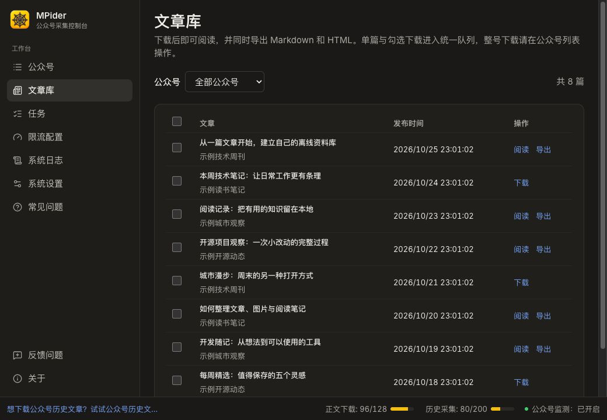

> 本文整理自 2026-11-16 的原稿，操作说明对应 [MPider v2.0.1](https://github.com/areyoubugcoder/mpider/releases/tag/v2.0.1)。当前功能与环境要求以[最新发行说明](https://github.com/areyoubugcoder/mpider/releases/latest)为准。

账号是自己的，风险也由自己承担，导出文章却还要另付费。我们觉得这不合理，所以 MPider 选择免费开源。核心采集逻辑、凭证如何处理，都能从源码核查，用户可以看清楚再决定怎么用。

MPider 可以下载公众号文章的正文和图片，也能做公众号监测。这里说的监测是「主页识别」。先在 MPider 里开启，再到微信手动打开目标公众号主页，工具会登记公众号与会话。之后由你发起列表采集和正文下载。

## 两种导出格式会各复制一份图片吗？

文章库用于查看文章列表、下载正文与导出离线文件。截图为公开版本的演示界面，具体操作以本文注明的版本和最新发行说明为准。

假设你在整理一个陶艺工作室公众号发布的釉色图鉴。你想用 HTML 在浏览器里对照成品照片，也想用 Markdown 给几篇文章加上试釉笔记。MPider 一次就能导出两种格式，它们使用同一个图片目录。同一次导出中，内容相同的图片只保存一份。选中的几篇图鉴如果用了同一张釉色对照图，都可以引用那份图片。

1. 在「公众号」页开启「主页识别」，到微信打开工作室的公众号主页。看到公众号登记后，在对应行点击「采集历史文章」，获取相关旧文列表。
2. 在「文章库」筛选这个公众号，勾选要整理的图鉴并下载正文。等选中的正文全部下载好，再导出这几篇。
3. 打开导出目录中的 index.html 浏览图鉴。需要记笔记时，到 articles 文件夹打开对应的 Markdown。保留导出根目录里的 images 文件夹，两种格式都要从那里找配图。

如果打算搬到另一台电脑，把整个导出目录一起复制。打开几篇包含釉色照片的文章检查效果，缺图时可回到原文核对。导出使用已经保存的图片，打开离线文件不会自动补下缺少的配图。

当前版本适用于 Windows 10/11 x64，需要 WebView2。采集已验证微信 4.1.15.56 x64，首次登记需要已登录且可操作的微信桌面。使用个人微信号可能受到限制或封禁，请避开重要账号，只保存有权处理的内容。

QQ 交流群 https://qm.qq.com/q/s4JavFxA3e

项目源码 https://github.com/areyoubugcoder/mpider

操作视频 https://xhslink.cn/o/8c23uHExcT6

客户端下载 https://github.com/areyoubugcoder/mpider/releases/latest

官网 https://mpider.followto.us

## 公开资料

- [项目说明](https://github.com/areyoubugcoder/mpider/blob/v2.0.1/README.md)

- [Windows 使用说明](https://github.com/areyoubugcoder/mpider/blob/v2.0.1/docs/windows-standalone.md)

- [常见问题](https://github.com/areyoubugcoder/mpider/blob/v2.0.1/docs/faq.md)
