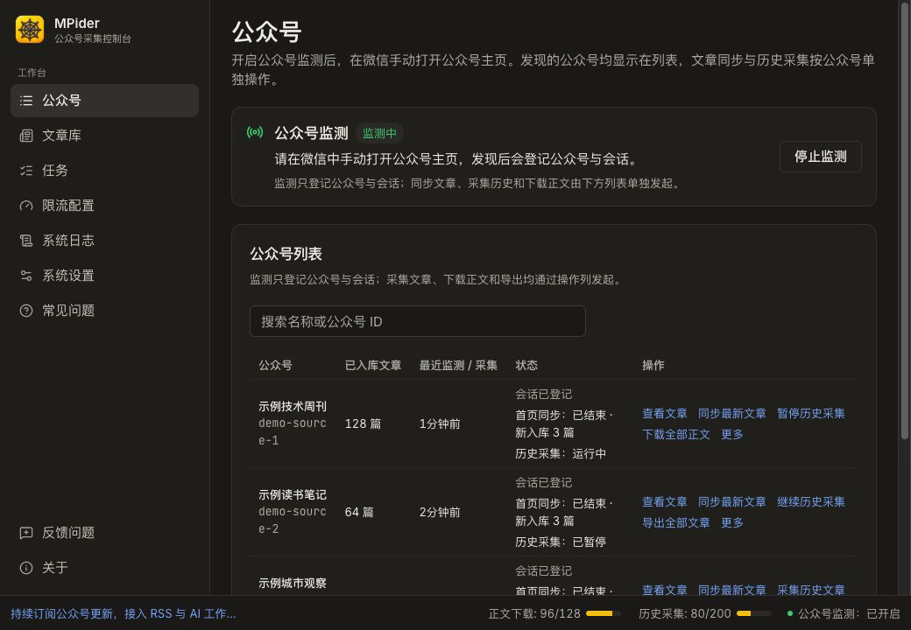

> 本文整理自 2026-11-22 的原稿，操作说明对应 [MPider v2.0.3](https://github.com/areyoubugcoder/mpider/releases/tag/v2.0.3)。当前功能与环境要求以[最新发行说明](https://github.com/areyoubugcoder/mpider/releases/latest)为准。

账号是自己的，风险也由自己承担，导出文章却还要额外付费。我们觉得这种体验不合理，所以 MPider 选择免费开源。核心采集逻辑和凭证处理可供核查，把知情权和选择权交还给用户。

MPider 可以下载公众号文章的正文和图片，也能做公众号监测。这里的监测是「主页识别」。开启后，到微信手动打开目标公众号主页，工具会登记公众号和会话，再由你分别发起列表采集和正文下载。

比如你想在 Windows 电脑上整理古建公众号里的斗拱入门文章，看到项目用了 Python，担心下载后还要先配一套开发环境。正式客户端已经带上运行所需的 Python 和依赖，使用发行包时可以直接按使用说明安装或完整解压。

第一步，从项目的 GitHub Releases 下载 Windows x64 正式客户端，按该版本附带的 SHA256SUMS 核对文件摘要。安装版按安装流程操作。选便携 ZIP 时，把整个包解压到可写目录，运行其中的 MPider.exe，并保留旁边的 runtime 文件夹。

第二步，确认电脑装有 WebView2，以及项目当前验证过的 Windows 微信版本。便携版首次使用时，设置中的 Python 路径保留默认 python，程序会优先使用随包携带的运行环境。

第三步，在 MPider 的「公众号」页开启「主页识别」，到微信手动打开古建公众号主页。登记成功后，按需要同步首页或采集历史文章，在文章库挑选斗拱入门图文，下载正文和结构配图。

客户端准备好后，在公众号页开启主页识别并登记目标公众号。截图使用演示数据。

下载完成后，可以在软件里离线阅读，也可以将选中的图文同时导出为 Markdown 和 HTML。打开导出目录的 index.html，核对构件照片与解说，再作为学习资料使用。遇到环境或版本不匹配时，先对照对应版本说明排查。

当前客户端适用于 Windows 10/11 x64，需要 WebView2。采集已验证微信 4.1.15.56 x64，首次登记需要已登录且可以操作的微信桌面。使用个人微信号可能受到限制或封禁，请避开重要账号，只保存有权处理的文章。

QQ 交流群 https://qm.qq.com/q/s4JavFxA3e

项目源码 https://github.com/areyoubugcoder/mpider

操作视频 https://xhslink.cn/o/8c23uHExcT6

客户端下载 https://github.com/areyoubugcoder/mpider/releases/latest

官网 https://mpider.followto.us

## 公开资料

- [项目说明](https://github.com/areyoubugcoder/mpider/blob/v2.0.3/README.md)

- [Windows 使用说明](https://github.com/areyoubugcoder/mpider/blob/v2.0.3/docs/windows-standalone.md)

- [常见问题](https://github.com/areyoubugcoder/mpider/blob/v2.0.3/docs/faq.md)
