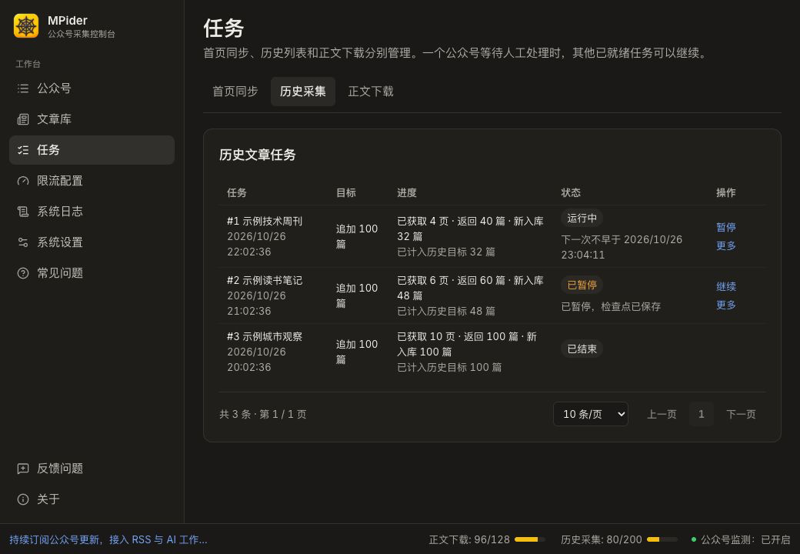

MPider 免费开源，向用户免费提供本地文章导出。微信账号属于用户，使用风险也由用户自行承担。我们公开核心采集逻辑和凭证处理，让用户核查工具如何操作自己的账号，再决定是否使用。

MPider 支持下载公众号文章的正文和图片，也提供公众号监测。这里说的监测是「主页识别」：打开开关后，在已登录的微信里手动打开公众号主页，登记公众号和会话，再回到 MPider 发起列表采集和正文下载。

假如合唱团要把公众号里的发声练习和排练通知带到没有网络的场地，正在下载图文时，MPider 提示有新版。用安装版时，可以先预下载更新包，等任务完成或暂停后再安装，重启后核对文章和任务进度。离线出发前，先打开一篇已下载文章，确认要用的练习图已保存。

## 下载更新包时可以继续使用

1. 在安装版打开「系统设置 → 版本更新」。发现新版后，点击「预下载安装包」。检查到新版时，仍由你决定何时下载和安装。
2. 预下载期间可以继续查看文章。看到「安装包已准备好，可稍后启动更新」提示时，更新包已经下载并通过签名校验。你可以继续当前工作，之后再点「安装并重启」。已校验的安装包会保存在本机，正常退出后下次启动也能继续安装。
3. 如果下载失败或签名校验未通过，先看更新区的提示。下载不完整或签名不符的安装包无法进入可安装状态，按提示重新下载即可。

## 安装前暂停任务，重启后核对进度

任务页演示图，使用示例数据。此处用来定位采集和正文任务，版本更新入口在「系统设置」。

1. 装更新之前，先在「任务」里看历史采集、正文下载等任务是否仍在运行。可以等当前任务完成，也可以先暂停。确认「安装并重启」后程序会退出，正在进行的请求会中断。
2. 重启后，在文章库打开一篇已下载的练习文章，核对正文和图片。回到「任务」检查未完成任务的状态和已有进度，再选择继续。历史采集如果提示更新会话，按提示在微信手动打开目标公众号主页。
3. 要带走排练资料，就在文章库选中已有正文的文章并导出。MPider 会同时生成 Markdown、HTML 和已经保存的图片。离线前打开导出目录的 `index.html`，确认排练通知和练习图都能看到。

## 版本与适用范围

版本资料核对日期为 2026 年 11 月 26 日（UTC）。应用内更新步骤以 [MPider v3.0.0 正式发行版](https://github.com/areyoubugcoder/mpider/releases/tag/v3.0.0)的 Windows x64 安装版为准，按钮文案可对照[该版本的更新界面源码](https://github.com/areyoubugcoder/mpider/blob/v3.0.0/frontend/src/components/AppUpdater.tsx#L89-L111)。

## 便携版怎样换新版

1. 在「系统设置」查看数据目录。暂停任务，从托盘退出旧程序，再备份完整的数据目录。
2. 从 GitHub Releases 下载新版 ZIP，完整解压到新目录，保留主程序旁的运行环境。
3. 用同一 Windows 用户启动新版，在「系统设置」确认数据目录，再核对文章库和任务进度。

## 运行环境与账号风险

按 [v3.0.0 的环境说明](https://github.com/areyoubugcoder/mpider/blob/v3.0.0/README.md#下载与安装)，采集需要 Windows 10/11 x64、WebView2 和已登录的微信。4.1.15.56 x64 是该版本已验证的微信环境，其他微信版本的适配范围请查对应发行说明。个人微信号使用此类工具可能被限制或封禁，请避开重要账号，只处理有权保存的内容。

## 下载和交流

- QQ 交流群 [https://qm.qq.com/q/s4JavFxA3e](https://qm.qq.com/q/s4JavFxA3e)
- 项目源码 [https://github.com/areyoubugcoder/mpider](https://github.com/areyoubugcoder/mpider)
- 操作视频 [https://xhslink.cn/o/8c23uHExcT6](https://xhslink.cn/o/8c23uHExcT6)
- 客户端下载 [https://github.com/areyoubugcoder/mpider/releases/latest](https://github.com/areyoubugcoder/mpider/releases/latest)
- 官网 [https://mpider.followto.us](https://mpider.followto.us)

[知乎原文](https://zhuanlan.zhihu.com/p/2109557936443936835)
